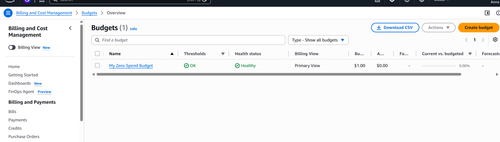
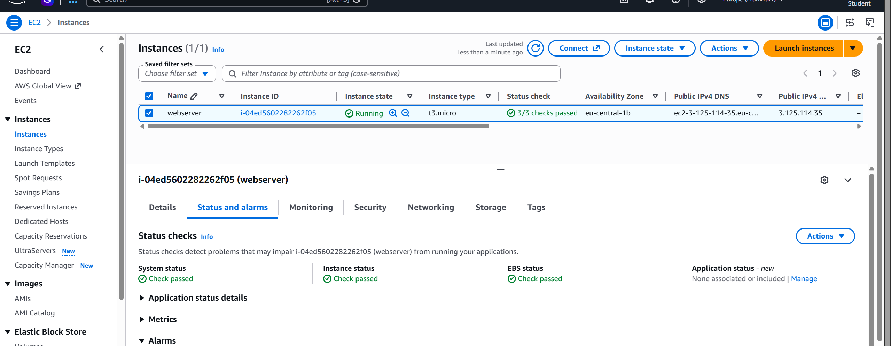
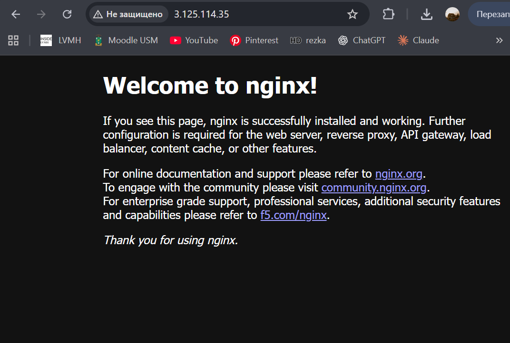
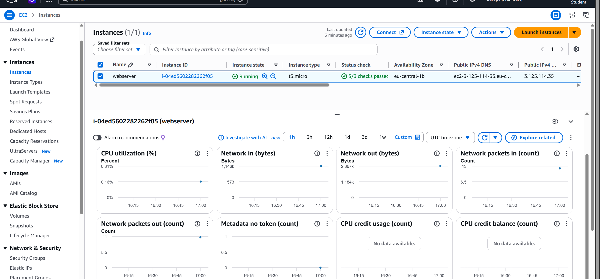
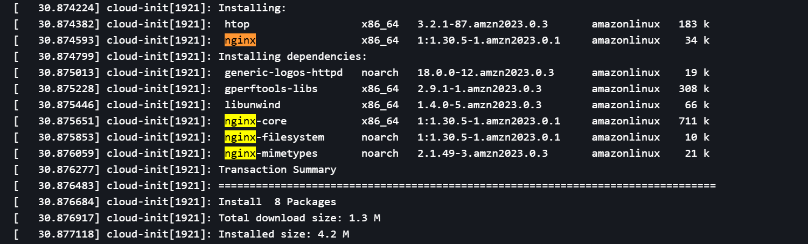
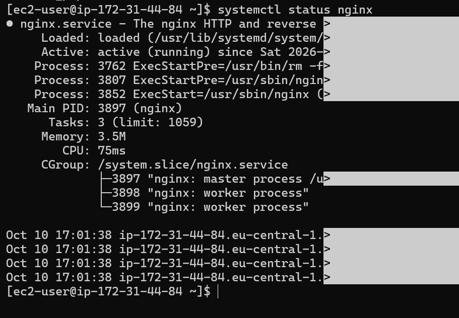
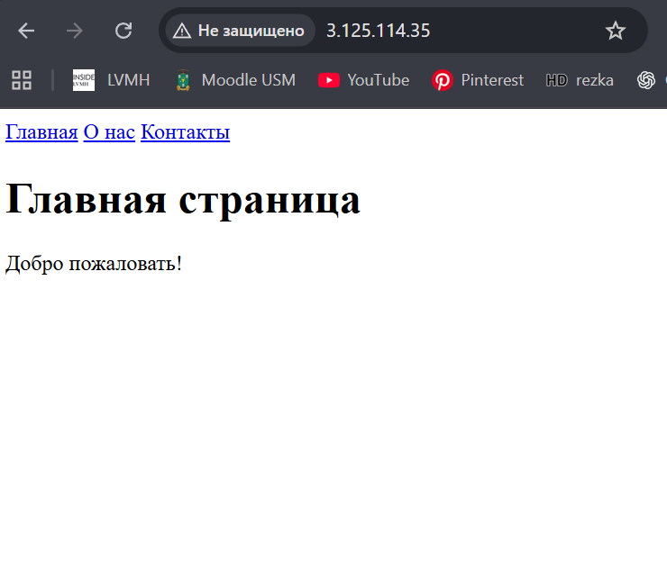
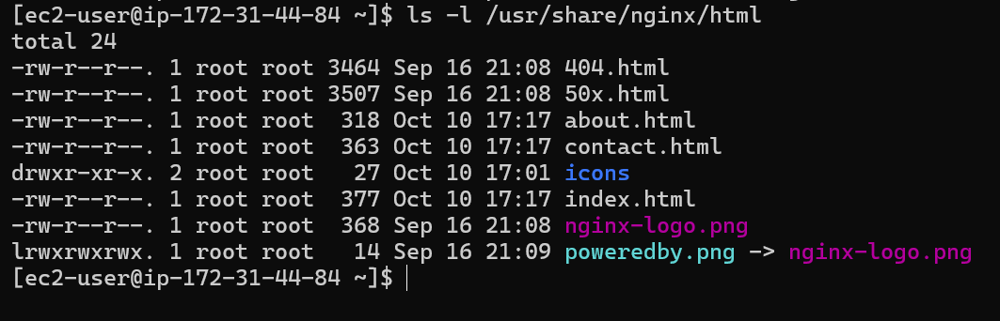
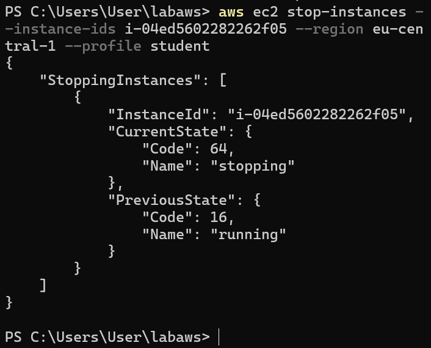

# Отчёт по лабораторной работе AWS

## 1. 
- ФИО: Кайнар Анна
- Группа: IA2403
- Выбранный уровень: Продвинутый

---

## 2. Задания базового уровня

Задание 1: бюджет ZeroSpend в списке Budgets.

Задание 2: экземпляр webserver в состоянии Running с пройденными проверками.

Задание 3: страница nginx в браузере по публичному IP.

Задание 4: вкладка Monitoring и фрагмент System log с установкой nginx.

Задание 5: успешное подключение по SSH и вывод systemctl status nginx.

Задание 6: ваш сайт в браузере и вывод ls -l /usr/share/nginx/html.

Задание 7: команда aws ec2 stop-instances и её вывод.

---

## 3. Задания продвинутого уровня

Вход в базу по паролю: psql ... -c "SELECT 1;" возвращает 1.

Вывод php bin/init-db.php: Database is ready.

Вывод sudo nginx -t: syntax is ok, test is successful.

Приложение TimeCapsule в браузере по публичному IP.

Страница /health: {"status":"ok","db":"ok",...}.

Новая версия с моей надписью в подвале страницы.

Ошибка 500 после выпуска сломанной версии.

Работающий сайт после git revert и повторного деплоя.

## Архитектура

Схема развёртывания TimeCapsule на одном экземпляре EC2.

ADR: [docs/adr/0001-deploy-method.md](docs/adr/0001-deploy-method.md)
