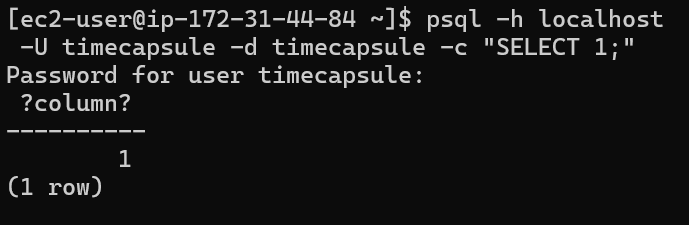
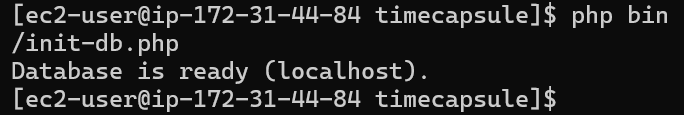
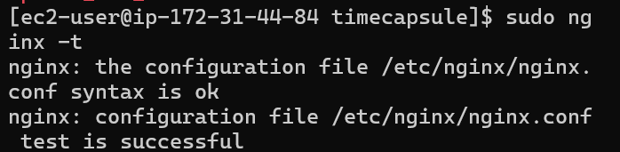
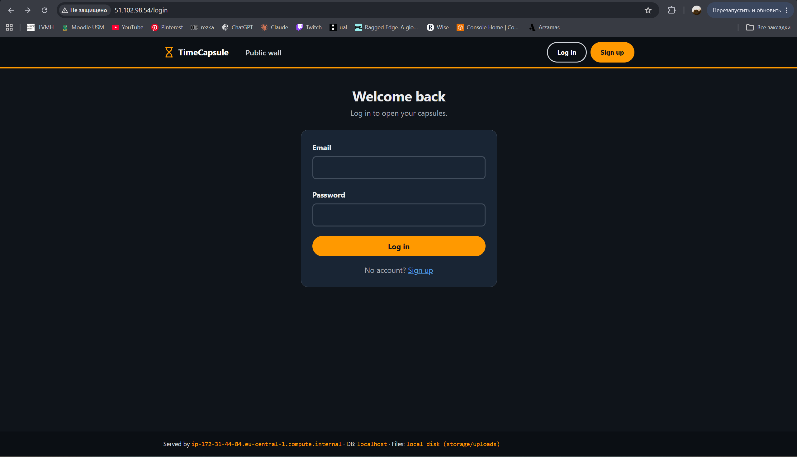
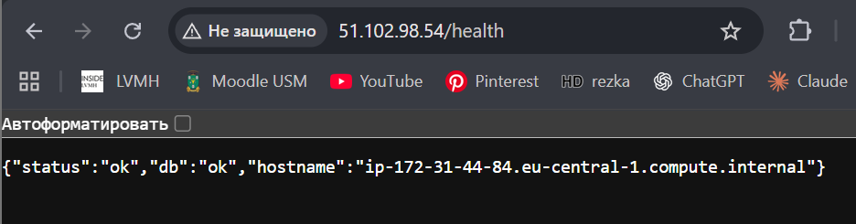
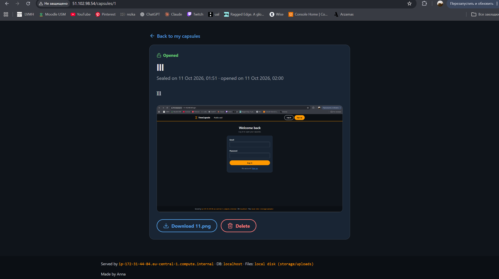
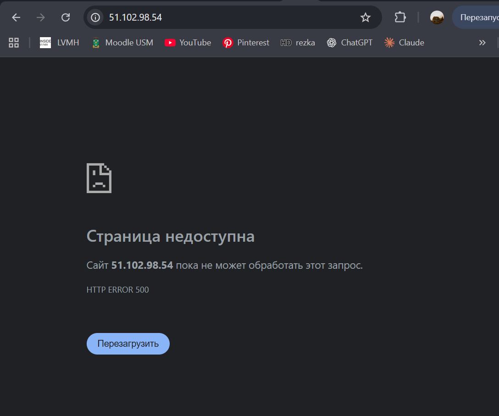
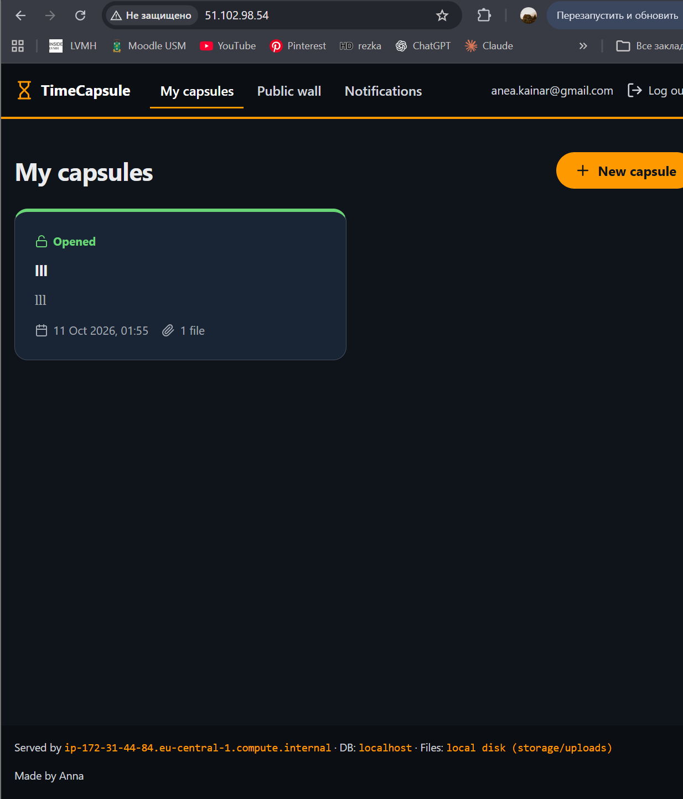
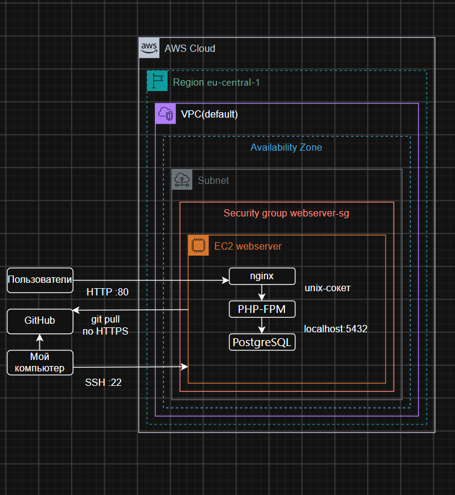

# Отчёт по 2 лабораторной работе AWS

## 1. 
- ФИО: Кайнар Анна
- Группа: IA2403
- Выбранный уровень: Продвинутый

---

## 2. Задания базового уровня

Задание 1: бюджет ZeroSpend в списке Budgets.

Задание 2: экземпляр webserver в состоянии Running с пройденными проверками.

Задание 3: страница nginx в браузере по публичному IP.

Задание 4: вкладка Monitoring и фрагмент System log с установкой nginx.

Задание 5: успешное подключение по SSH и вывод systemctl status nginx.

Задание 6: ваш сайт в браузере и вывод ls -l /usr/share/nginx/html.

Задание 7: команда aws ec2 stop-instances и её вывод.

---

## 3. Задания продвинутого уровня

Задание 9:Вход в базу по паролю: psql ... -c "SELECT 1;" возвращает 1.

Задание 10: Вывод php bin/init-db.php: Database is ready.

Задание 11: Вывод sudo nginx -t: syntax is ok, test is successful.

Задание 11.1: Приложение TimeCapsule в браузере по публичному IP.

Задание 11.2: Страница /health: {"status":"ok","db":"ok",...}.

Задание 13: Новая версия с моей надписью в подвале страницы.

Задание 13.1: Ошибка 500 после выпуска сломанной версии.

Задание 13.2: Работающий сайт после git revert и повторного деплоя.

## Архитектура

Схема развёртывания TimeCapsule на одном экземпляре EC2.

ADR: [https://github.com/kkkiar-cloud/timecapsule/blob/main/docs/adr/0001-deploy-method.md](https://github.com/kkkiar-cloud/timecapsule/blob/main/docs/adr/0001-deploy-method.md)

## Ответы на контрольные вопросы

### Часть 1

**1. Что разрешает политика AdministratorAccess? Почему для повседневной работы нельзя использовать root?**

AdministratorAccess даёт почти все права в AWS. Root опасно использовать каждый день, поэтому создают IAM-пользователя.

**2. Что такое User data и когда выполняется скрипт? Выполнится ли он повторно после перезагрузки?**

User data — скрипт, который выполняется при первом запуске EC2. После перезагрузки обычно не повторяется.

**3. Какая из проверок (System, Instance, Attached EBS) указывает на проблему, которую можешь исправить ты, а какая на проблему стороны AWS?**

System проверяет сервер AWS, Instance — виртуальную машину, Attached EBS — диски. Проблемы Instance чаще исправляю сама.

**4. В каких случаях стоит включать детальный мониторинг?**

Когда важно отслеживать нагрузку каждую минуту. Он платный.

**5. Почему для входа на экземпляр EC2 используется ключ, а не пароль?**

Ключ безопаснее пароля, потому что его сложнее подобрать. Приватный ключ хранится у меня.

**6. Что делает scp и чем он похож на ssh?**

SSH подключает к серверу, а SCP передаёт файлы. Оба используют защищённое соединение.

**7. Чем Stop отличается от Terminate? За что продолжаешь платить, пока экземпляр остановлен?**

Stop останавливает EC2, но сохраняет данные. Terminate удаляет экземпляр. За EBS-диск при остановке всё ещё нужно платить.

### Часть 2

**8. Почему папка vendor/ и файл .env не попали в репозиторий?**

Они указаны в .gitignore. Библиотеки можно восстановить через Composer, а .env содержит секреты.

**9. Почему пакеты на сервере устанавливаются вручную, а не добавляются в User data?**

User data повторно не запускается, поэтому необходимые пакеты я установила вручную.

**10. Почему пароль к базе данных хранится в файле .env на сервере, а не в коде в репозитории? Почему публичный репозиторий безопасен для этого приложения?**

Пароль хранится в .env на сервере и не попадает в репозиторий. Поэтому посторонние не могут получить его из кода.

**11. Что может увидеть посетитель сайта в момент git pull? Что случится с сайтом, если после git pull не выполнить composer install?**

Сайт может временно работать с разными версиями файлов. Без composer install могут отсутствовать нужные библиотеки и появиться ошибка.

**12. Почему /health отвечает ok, хотя главная страница не работает? Что на самом деле проверяет этот адрес? Чего не хватает такой проверке?**

/health проверяет приложение и подключение к базе, но не главную страницу. Поэтому нужна дополнительная проверка страниц сайта.

**13. Сколько времени сайт был сломан? Из каких шагов сложилось это время? Как можно было бы сократить его?**

Сайт не работал примерно 5 минут. В моем случае с 13:39 до 13:44. Время ушло на поиск ошибки, откат кода и обновление сервера. Сократить его можно автоматизацией.

**14. Как проходит запрос от браузера до базы данных в моём развёртывании? Какую роль играет каждая программа?**

Браузер отправляет запрос nginx, тот передаёт PHP-запрос в PHP-FPM, а PHP при необходимости обращается к PostgreSQL. Затем страница возвращается в браузер.

**15. Почему сервер может скачивать код из репозитория, но не может отправлять в него изменения? Почему для сервера это правильно?**

Публичный репозиторий позволяет скачивать код без авторизации, но для отправки изменений нужны права. Это защищает репозиторий от посторонних изменений.

**16. Что произойдёт с загруженными пользователями файлами, если удалить экземпляр EC2? Как это связано с тем, что известно об EBS?**

При Terminate файлы на корневом EBS по умолчанию удаляются вместе с экземпляром. При Stop они сохраняются.

**17. Что общего у моей последовательности команд (вариант A) с тем, что делают системы CI/CD? Чего в моём процессе ещё не хватает?**

Я вручную обновляю код и устанавливаю библиотеки, как это делают системы CI/CD. Но мне не хватает автоматических тестов, деплоя и отката при ошибках.
